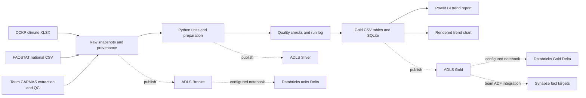

# AquaAgri Egypt

DEPI Data Engineering graduation project: combine irrigation, crop production,
and climate data to analyze agricultural water use and reporting gaps in Egypt.

## Repository structure

```text
datasets/
  raw/          Original source files, kept unchanged
src/            Reusable Python code for the data pipeline
notebooks/      Data exploration and development notebooks
docs/           Source descriptions, data dictionary, and design documents
reports/        Findings, charts, and Power BI deliverables
```

`datasets/processed` contains local Silver preparation, `datasets/gold` contains
the analytical model and SQLite warehouse, and `datasets/quality` contains the
append-only quality log. `powerbi/` contains the native trend report. Empty folders
contain `.gitkeep` because Git tracks files rather than empty folders.

## Naming conventions

- Use lowercase `snake_case` for new folders and authored filenames, for example
  `climate_ingestion.py` and `data_dictionary.md`.
- Keep original downloaded filenames inside `datasets/raw/`. Group files by source,
  for example `datasets/raw/capmas/` and `datasets/raw/world_bank/`.
- Include the period in data filenames you generate, for example
  `climate_2016_2020.csv`. Use `YYYY-MM-DD` for a full date in a filename.
- Use descriptive Python function and variable names in `snake_case`.
- Do not overwrite raw data with cleaned output. Choose processed-data storage
  when implementing that pipeline stage.
- Keep passwords, access tokens, and connection strings out of Git. Local `.env`
  files are ignored.

## Team workflow

1. Update your local `main` branch before starting a task.
2. Create a task branch, for example `mahmoud/climate-ingestion`.
3. Commit only files related to that task, with a descriptive commit message.
4. Push the branch and open a pull request for review before merging into `main`.

## Available steps

- [Local climate ingestion](docs/climate_ingestion.md): download the team's
  original climate workbooks and record source metadata using Python.
- [Climate reshaping](docs/climate_reshape.md): prepare 2016-2020 annual
  temperature and rainfall tables and combine them by governorate/year.
- [FAOSTAT unit preparation](docs/faostat_units.md): standardize units while
  retaining original values, identifiers, flags, and missing data.

See [Mahmoud's handoff](docs/mahmoud_handoff.md) for run instructions, available
outputs, validation, and remaining dependencies.

## Run the delivered local pipeline

Python 3.9+ (offline after dependency installation; inputs are included):

```sh
python3 -m venv .venv
source .venv/bin/activate
python -m pip install -r requirements.txt
python src/run_pipeline.py
python -m unittest discover -s tests -v
```

Windows activation: `.venv\Scripts\activate`. Reruns replace business outputs
without duplicating facts and append a new quality run. Failures exit nonzero.
The team's earlier `scripts/` files are retained unchanged; use portable `src/`
commands instead of their hardcoded Windows paths.

## Architecture



Solid paths show the local pipeline. The separate live team integration now runs
on Databricks serverless and writes Delta into ADLS Silver; Gold/Synapse serving
remains pending. See the [live execution report](docs/azure_live_execution_2026_11_23.md).
No new classic cluster or dedicated SQL pool was provisioned.

Both Spark notebooks also pass a GitHub Actions smoke test using local files
and Parquet sinks. This verifies their transformations, not live ADLS access
or Delta transaction writes.

## Gold outputs

| Output under datasets/gold/ | Grain and contents |
| --- | --- |
| fact_water_usage.csv | 4,404 governorate/crop-or-group/year/season water records joined to annual climate |
| fact_water_annual.csv | 218 annual records preserving alternative canals/Aswan measurement bases |
| fact_crop_national.csv | 381 Egypt/crop/year records, source flags, and climate context |
| fact_climate_annual.csv | 135 governorate/year climate records |
| dim_*.csv | Governorate, crop, date and source integration dimensions |
| coverage_governorate_year.csv | Presence/absence of supplied CAPMAS data, never assumed zero irrigation |
| aquaagri.sqlite | Queryable local warehouse with unique fact-grain indexes |

`datasets/quality/data_quality_log.csv` records each run's checks and warnings.
`sql/validation_queries.sql` contains useful local queries. Nineteen tests cover units,
nulls, source preservation, logging, fact integrity, measurement bases and reruns.
GitHub Actions builds/tests the pipeline and dry-runs publication on pull requests.

For the final T12/T17/T22 integration commands, see
[execution handoff](docs/t12_t17_t22_execution.md). Each local run now imports the
25 available CAPMAS table-check results into the same quality log. Exported
Great Expectations results can be placed in `datasets/quality_inputs/`; none
have been supplied by Nada yet. `src/load_synapse.py` loads existing target
fact tables and appends quality history using the team's authenticated identity.

## Data interpretation

- CAPMAS thousand_m3 becomes m³; feddans become hectares using 0.42 ha/feddan.
  FAOSTAT tonnes become kg and thousand hectares become hectares. Celsius, mm,
  hectares and kg/ha retain their units. Original source fields remain unchanged.
- Detail facts exclude total rows/columns; annual total facts are separate.
  Never add annual and detailed water facts, or add canals and Aswan together.
- Source extraction warnings remain `review_required`. A working pipeline does
  not certify PDF extraction accuracy; filter or disclose review rows in analysis.
- Observed governorate crop production is absent. National production is not
  allocated to governorates. Local production and water productivity stay null.
- Country crop trends use an unweighted mean of 27 governorates' climate. This is
  descriptive context, not crop-weighted climate or evidence of a causal effect.
- `config/governorate_aliases.csv` is an explicit integration adapter pending
  alignment with Nour's final master; source names and codes are retained.

## Power BI and charts

Open `powerbi/AquaAgri.pbip` in a current Windows Power BI Desktop, then refresh
to load its embedded snapshot. No local data paths or credentials are embedded.
Rebuild with `python src/run_pipeline.py` to refresh that snapshot. The native
report has three line charts: yield for Wheat/Rice/Maize, mean temperature and
mean rainfall. The warehouse keeps all crops; these three keep the report readable.
JSON schemas/visual bindings pass Microsoft's authoring CLI. Desktop rendering,
M/DAX execution and Service publication still require Windows/Power BI access
and have not been claimed as tested on this Mac.

A verified static preview is in `reports/trends/climate_vs_yield.png`; its source
data is in the adjacent CSV. Annual crops and governorate climate have separate
model tables with no relationship that would allocate national crop production.

## Azure execution

Current deployed notebook, output paths, run links and remaining permissions:
[live execution report](docs/azure_live_execution_2026_11_23.md).
The commands below describe the optional local-preview publisher; the successful
cloud run uses the team's T20 Delta inputs through notebook 03.


```sh
python -m pip install -r requirements-azure.txt
python src/publish_adls.py --dry-run
# Authenticate via the team's supported DefaultAzureCredential method first:
python src/publish_adls.py --account ACCOUNT --filesystem FILESYSTEM
```

Uploads create a new `aquaagri/runs/<timestamp>/` prefix; Bronze history is never
overwritten. Source hashes and latest quality-run identity are checked first.
Upload sizes and a publication manifest are recorded. Spark/Delta notebooks and
dedicated Synapse fact DDL are provided. See [Azure runbook](docs/azure_runbook.md).

## Additional handoff

- [Model grains and quality-log interface](docs/data_model.md)
- [Presentation rehearsal notes](docs/presentation_rehearsal.md)

Live T12 logging and T17 unit conversions ran successfully on the team's Azure
environment. T22 produced 4,404 joined water rows in Silver staging using the
team's governorate IDs. Gold publication and Synapse serving still need platform
access. Power BI Windows acceptance and the human rehearsal also remain.
